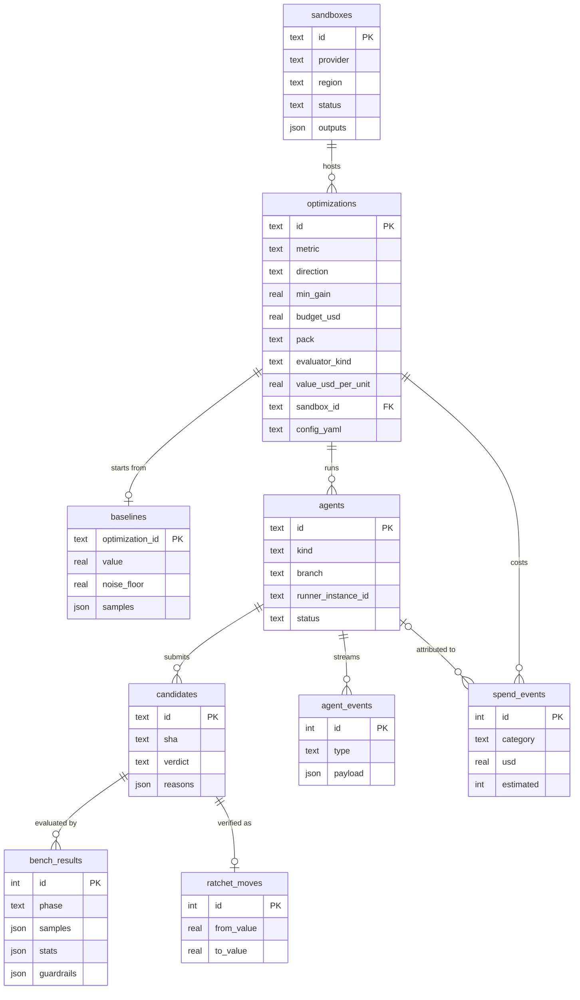

# Ratchet v0 — Architecture

> A ratchet only turns one way. Ratchet lets coding agents try to improve a
> business metric — cut costs or grow profit — and keeps a change only when a
> trusted evaluator confirms it is better, on data the agents never saw.

Status: draft for discussion. UI design: "Ratchet App Design" canvas
(Midnight Brass), six screens; see §9.

> **Superseded in part:** the simplified product model in [`SIMPLIFIED_MODEL.md`](SIMPLIFIED_MODEL.md) (settings, harness detection, local agents, `environment:` in `ratchet.yaml`, evaluator templates, invisible sandbox) takes precedence where the two differ.

## 0. Product shape: a generic core with domain packs

Businesses want two things: lower costs and higher profit. Ratchet is a
**generic verified-improvement platform**: the user declares an objective (a
metric, its direction and what a unit of it is worth in dollars), a trusted
**evaluator**, guardrails and a sealed **holdout**; agents propose changes; the
ratchet keeps only verified wins. The core never looks at the domain.

| | Perf pack (v0) | Forecasting pack (next) | Cost pack (later) |
|---|---|---|---|
| Metric | p95 latency ↓ | WAPE / MAPE ↓ | $ per run ↓ |
| Evaluator `kind` | `benchmark` (k6, criterion, hyperfine) | `backtest` (rolling-origin) | `simulation` / pipeline run + cost meter |
| Holdout | hidden traffic trace | most recent unseen period | held-out partition |
| Domain guardrails | tests, API contract, error rate, memory | no leakage / look-ahead, interface preserved, train-time cap | output equals baseline, SLA |
| Noise | run-to-run variance | seed / fold variance | run variance |
| Value model | $ per ms (infra + conversion) | $ per WAPE point (inventory, stockouts) | $ per $ saved |

A **pack** (now simply a template *category*: `perf`, `forecasting`, `llm`; see docs/SIMPLIFIED_MODEL.md and docs/templates.md) is evaluator templates + guardrails + holdout strategy + a default
value model + an agent brief, for one domain. Go to market one pack at a time;
the platform is the core underneath. Headline result: **$ value per year
created per $ spent** (`estimateValue`, `returnOnSpend` in core), labelled
*estimated* until measured in production.

## 1. v0 scope

v0 ships the core plus the **perf pack**: latency, throughput, cold start,
build time, cost per run — anything with a reproducible benchmark that prints a
number. The forecasting pack is the next milestone (§10).

| In scope | Out of scope (later) |
|---|---|
| Desktop app (Electron + React, macOS first) as mission control | Hosted controller / web dashboard |
| Agents: **Claude Code** and **Codex**, run headless on Ratchet **agent runners** (EC2 in the sandbox) | Vendor cloud sessions (Claude Code on the web, Codex cloud) as an extra adapter; Grok, OpenCode |
| Cloud: **AWS** only | Azure, GCP, cross-cloud placement |
| GitHub repos with a reproducible benchmark (k6, criterion, pytest-benchmark, hyperfine, custom command) | Repos without a benchmark; ML / forecasting objectives |
| One optimization = one benchmark metric, one budget, one time limit | Multi-metric objectives, cross-agent collaboration |
| Result delivered as a PR plus a benchmark report | Autonomous production deployment |

## 2. Topology

```
┌─────────────────── Ratchet desktop (Electron) ──────────────┐
│ Optimization engine · Ratchet · Budget guard · Ledger · UI  │
│ Runner control · GitHub watcher                             │
│ AWS controller (cost meter, reaper, bench runner)           │
└───────┬──────────────────────────────┬──────────────────────┘
        │ AWS APIs + SSM (admin)       │ watch branches
        ▼                              ▼
 AWS sandbox account                 GitHub
 ├─ agent runner: claude -p ───push──▶ ratchet/<opt>/claude
 ├─ agent runner: codex exec ──push──▶ ratchet/<opt>/codex
 │    └─ experiments: tagged EC2, S3 artifacts (agent boundary)
 ├─ trusted bench runner (eval-only role) ◀── re-bench candidates
 └─ S3 sealed traces (deny agents)
        ▲ model APIs (Anthropic, OpenAI) via runner egress
```

Principles:

1. **The Mac is mission control, not the runtime.** Agents run headless on
   agent runners in the sandbox, each driven by a small `ratchet-runner` loop;
   experiments and benchmarks run on AWS too. Work continues if the lid closes.
2. **GitHub is the bus.** Agent = branch, candidate = commit, winner = PR.
3. **Agents never touch the trusted path.** Only benchmarks the app launches,
   with credentials no agent holds, move the ratchet.
4. **Budget is enforced by AWS permissions and the app, never by prompt
   compliance.**

## 3. Core concepts

| Concept | Definition |
|---|---|
| **Optimization** | Repo, benchmark, metric, agents, USD budget, time limit, stop rules |
| **Benchmark** | Command from `ratchet.yaml` that emits metrics (e.g. k6 `http_req_duration.p95`) |
| **Metric** | Name, direction (lower / higher is better), minimum gain, noise floor |
| **Agent** | One Claude Code or Codex instance, run headless on its own agent runner, working on its own branch `ratchet/<opt>/<agent>` |
| **Agent runner** | EC2 instance in the sandbox that hosts one agent plus the `ratchet-runner` loop |
| **Candidate** | A commit an agent submits, with cost attributed |
| **Guardrails** | Hard pass/fail checks: tests, API contract, error rate, peak memory |
| **Bench runner** | Trusted re-benchmark of every candidate on pinned hardware |
| **Hidden trace** | Sealed workload agents never see; used to confirm a win |
| **Ratchet** | Pointer to the best *verified* candidate; only moves forward |
| **Ledger** | Append-only record of every spend event, candidate and result |

### Ratchet rule

A candidate becomes a **verified win** iff:

1. all guardrails pass, and
2. its bench result (N runs on pinned hardware) beats the current best by more
   than `max(noise_floor, min_gain)`, and
3. a confirm run on a **fresh instance** against the **hidden trace** also
   beats the current best.

Otherwise it is *rejected* (no gain), *failed confirm* (bench win that did not
hold on the hidden trace) or *blocked* (guardrail failed). The noise floor comes
from running the baseline N times before any agent starts.

## 4. Repository contract: `ratchet.yaml`

Where this section and docs/SIMPLIFIED_MODEL.md disagree, SIMPLIFIED_MODEL.md wins. The simplified form is the whole file
a repo needs; every older, more explicit config stays valid.

```yaml
version: 0
objective:
  metric: http_req_duration.p95   # key in the evaluator's JSON output
  direction: minimize
evaluator:
  template: http-latency          # an evaluator template: fills run / kind / machine / default guardrails
environment:                      # all optional
  image: .devcontainer/Dockerfile # toolchain for setup, guardrails and the evaluator
  machine: c7i.2xlarge            # bench hardware (default: the template's)
  region: us-east-1               # default: the app's
  network: [registry.npmjs.org]   # extra egress for agents / the dependency job
agent:
  instructions: RATCHET.md        # brief injected into every session
  allowed_instance_types: [c7i.2xlarge, c7i.xlarge, m7i.large]
```

and the same thing spelled out, with every optional knob set:

```yaml
version: 0
pack: perf                        # informational: the template category (perf, forecasting, llm)
objective:
  name: search-api p95 latency
  metric: http_req_duration.p95   # key in the evaluator's JSON output
  direction: minimize
  min_gain: 0.03                  # OPTIONAL. 3%; absent: calibrated from the baseline noise
  value:                          # business case (optional, can be set late)
    usd_per_unit: 1200            # $ per ms of p95 improvement
    period: year
    basis: estimated              # → measured once confirmed in production
    unit: ms
evaluator:                        # the trusted evaluation (legacy alias: bench)
  template: http-latency          # OPTIONAL. Either a template or a `run:` is required; `run:` wins when both are given
  kind: benchmark                 # benchmark | backtest | eval | simulation (default: the template's, else benchmark)
  ref: ratchet/bench              # protected ref holding the trusted evaluator (default ratchet/bench)
  run: k6 run bench/k6/search.js
  repeats: 5                      # OPTIONAL. Runs per candidate, also the baseline's; absent: calibrated
  noise_factor: 2                 # OPTIONAL. The k of the noise floor k x stddev(baseline) (default 2)
  hardware: c7i.2xlarge           # default: environment.machine, else the template's, else c7i.large
  deps: auto                      # auto | pnpm | npm | none: how dependencies reach the offline bench
  holdout: s3://sealed/search-trace.jsonl   # sealed; agents never see it
environment:                      # OPTIONAL, every key too
  image: .devcontainer/Dockerfile # repo-relative Dockerfile / devcontainer.json (protected)
  machine: c7i.2xlarge            # instance type
  region: us-east-1               # AWS region
  network: [registry.npmjs.org]   # host names; "*.example.com" wildcards allowed, no scheme / port / bare "*"
infra: ops/sandbox                # OPTIONAL, advanced: a custom OpenTofu module (see below)
guardrails:                       # absent: the template's defaults (none for a bare `run:`)
  - run: pytest -q
  - run: openapi-diff --base main
  - error_rate: "< 0.001"
  - peak_rss: "< 1.2x"
protected:                        # OPTIONAL: only ADDS to the automatic set below
  - tests/contract/**
agent:
  instructions: RATCHET.md        # brief injected into every session (required)
  allowed_instance_types: [c7i.2xlarge, c7i.xlarge, m7i.large]   # required
```

The evaluator comes from `evaluator.ref`, never from the candidate's tree, so an
agent cannot change how it is scored. A forecasting config looks the same with
`kind: backtest`, `metric: wape` and `holdout:` pointing at the latest unseen period.

**Evaluator templates** (`evaluator.template`). A template is a `ratchet.yaml` fragment, the evaluator's real files and a
`RATCHET.md` brief (docs/templates.md). `evaluator.template: http-latency` resolves, when the config is parsed, to the
template's command (`node bench/http-latency.mjs`), `kind`, machine and default guardrails; anything set explicitly wins.
Unknown ids, and the "Try a demo" entries, are config errors. `ratchet init --template <id>` or the app's "Use template"
puts the files into a repo through a pull request.

**Auto-calibrated statistics.** `evaluator.repeats`, `objective.min_gain` and `evaluator.noise_factor` are optional. The
baseline runs `repeats` times (5 when absent); from its coefficient of variation (CV = stddev / mean) the engine derives

- the resolution to detect `g = max(2 x CV, 1%)`;
- runs per candidate `n = ceil(18 CV² / g²)`, clamped to 3..15 (3 standard errors on the difference of two n-run medians);
- the win threshold `min_gain = g` rounded up to a readable step, and never below what the chosen `n` can resolve
  (`3 sqrt(2) CV / sqrt(n)`), so a capped `n` raises the threshold instead of pretending.

Any value set in ratchet.yaml is respected and the other is derived around it. With fewer than 3 baseline runs or a zero
mean noise cannot be measured and the old 3% default applies. The result is stored in `engine_kv` (`opt:<id>:calibration`),
announced as a `notice` event and returned by `EngineApi.calibration(id)` with a one-line explanation such as
"this metric is noisy (±9%); wins must beat 9%; each candidate is measured 5 times". The rule of §3 is unchanged: the
required gain is `max(noise_floor, min_gain × |best|)` with the calibrated `min_gain` and `noise_floor = k × stddev(baseline)`.

**Automatic protected paths.** A candidate that changes a protected path is blocked, and the bench takes protected files
from the evaluator ref. The set is computed (`effectiveProtected` in core; `EngineApi.protectedPaths(id)` returns it with the
reason for each entry) from:

| Source | Paths |
|---|---|
| the config | `ratchet.yaml` (the config path in use) |
| the evaluator | the template's files; every `bench/` or `eval/` directory that `evaluator.run` references (`dist/bench/x.js` also protects `bench/**`) |
| the environment | `environment.image` (and `.devcontainer/**` when it lives there), the `infra` module |
| install config | `pnpm-lock.yaml`, `package-lock.json`, `npm-shrinkwrap.json`, `yarn.lock`, `bun.lock`, `bun.lockb`, `.npmrc`, `.yarnrc`, `.yarnrc.yml`, `pnpm-workspace.yaml`, `.pnpmfile.cjs`, at any depth |
| the user | `protected:`, which only adds |

The bench overlays the config, evaluator, environment and user-listed files from the evaluator ref (lockfiles are pinned
through `evaluator.deps`) and still refuses to run when the evaluator ref holds none of the evaluator's files or of the
user's globs.

**`infra:`** (advanced, off by default) points at a custom OpenTofu module for the sandbox. It is read **only from the
protected ref** and validated against the sandbox contract (§7, `infra/contract.md`); a candidate's copy is never used, and the
path is protected so an agent cannot edit it. Parsing only checks that it is a repo-relative path; reading it from the
protected ref and checking the contract is the engine's and the sandbox provider's job.

**`evaluator.deps`** (optional, default `auto`) says how the candidate's
dependencies reach a bench that has no network. `auto` detects the package manager
from the lockfile at `evaluator.ref` (`pnpm-lock.yaml` -> `pnpm`; `package-lock.json`
or `npm-shrinkwrap.json` -> `npm`; neither -> nothing to do); `pnpm` / `npm` demand
that lockfile; `none` switches it off (the image provides whatever setup needs).
When the runner has a candidate setup (for example
`pnpm install --frozen-lockfile && pnpm build`), the packages come from a *snapshot*
of the base ref's lockfile that a separate short-lived machine with egress builds once
(`pnpm fetch` / `npm ci --ignore-scripts`, no lifecycle scripts, never candidate code),
and setup then installs from it with the package manager offline. Because of that,
**dependency changes are not allowed in v0**: a candidate whose lockfile differs from
`evaluator.ref`'s is `blocked` ("dependency changes are not allowed in v0: the bench has
no network") before anything runs, and the lockfile counts as protected without being
listed under `protected`. The local simulation applies the same rule. Details and
real-environment checks: `docs/real-env/bench.md` ("Dependencies on an offline bench").

**Template pull requests.** `EngineApi.proposeTemplate({ repoUrl, baseRef, templateId })` commits the template's files on a
new branch (`ratchet/template-<id>`) through `GitHost.commitFiles` and opens a PR (`openPullRequest` with no shas) whose
description lists what was added, what to fill in, and how to run a baseline (`ratchet validate`, `ratchet baseline`). It
refuses when the template's files already exist on `baseRef` unless `overwrite` is given.

## 5. Agents: local by default, cloud optional

Both agents have documented headless modes, so the same loop (`runRunnerLoop`) drives them either on
the user's machine or on EC2 machines Ratchet controls, instead of depending on vendor-hosted cloud
sessions. The evaluator never moves: bench and confirm instances always run in the cloud sandbox, so
measurements are on pinned hardware and the holdout never reaches the machine the agents work on
(`docs/SIMPLIFIED_MODEL.md`).

| | Claude Code | Codex |
|---|---|---|
| Headless entry point | `claude -p --output-format stream-json` (or Claude Agent SDK) | `codex exec --json` (or Codex SDK) |
| Continue a session | resume by session id | resume the previous exec session |
| Auth | Anthropic API key (subscription only where terms allow) | OpenAI API key or ChatGPT sign-in, per terms |
| Local sign-in check | `claude auth status`, credentials file / keychain item, `ANTHROPIC_API_KEY` | `codex login status`, `~/.codex/auth.json`, `OPENAI_API_KEY` |

### Where agents run (`agentsWhere`)

| | `local` ("This machine", the default) | `cloud` (unattended) |
|---|---|---|
| Control | `LocalRunnerControl` in `worktree` mode, in the app's main process | `SsmRunnerControl` over SSM + S3 |
| Adapter | the real `ClaudeCodeAdapter` / `CodexAdapter` on the **detected** binary | the same adapters on the runner image |
| Credentials | the user's own CLI login; no API key is passed unless the harness reports `api-key` auth | model keys in SSM Parameter Store, per-agent IAM role |
| Workspace | one local clone per optimization, one `git worktree` per agent, removed on stop / teardown | the runner's own clone |
| Laptop closed | the run pauses (the app holds a power-save blocker while a run is live) | keeps going |
| Cloud resources per agent | none (no identity, secret or runner instance) | identity, secrets, EC2 runner |

The engine takes `agentsWhere` per optimization (`createOptimization({ agentsWhere })`), else its
`agentsWhere` setting, else `local` when it was given a `localRunners` port, else `cloud`.

**Detection** (`detectHarnesses`, `packages/agents/src/detect.ts`) runs in the main process on launch and
on demand and returns `{ kind, installed, version, path, auth: 'signed-in' | 'api-key' | 'signed-out',
hint }` per harness. PATH is resolved like a login shell (`$SHELL -lc`) because a GUI app on macOS does
not inherit it. Auth asks the CLI's own non-interactive status command first, then checks that
credentials exist (never their contents), then API-key variables.

**Local agent environment** (`localAgentEnv`): the user's environment with the login-shell PATH, minus
anything that looks like a credential (`AWS_*`, `*_TOKEN`, `*_API_KEY`, ...). The harness's model key is
added back only for `api-key` auth, so a signed-in harness always uses the login. Git credentials stay
with the control (clone and push) and never reach the agent process. A local agent has the user's own
file and network permissions: the worktree isolates the git state, not the machine (Codex still runs in
its `workspace-write` sandbox).

**Local agents do not survive the app.** The loop lives in the main process. After a restart, polling a
lost agent reports it failed, so the engine ends the run instead of waiting. Use `cloud` for long
unattended runs.

### Sandbox lifecycle: invisible

With `sandbox.auto` (the live and hybrid runtimes) the engine owns the sandbox:

- created at the first run start in a region (`ratchet.yaml` `environment.region`, else the setting
  default `us-east-1`; one sandbox per region, `ratchet-sandbox` / `ratchet-sandbox-<region>`);
- reused while runs are active; every `tick()` looks at the idle clock (persisted in the ledger's kv table,
  so a sandbox that outlived the app is removed on the first tick after launch);
- destroyed once no run has been active for the idle window (default 30 min, `sandbox.idleMs`): finished
  runs are torn down first (identities, secrets, leftover instances), the destroy goes through the same
  orphan check as an explicit one, and a **teardown receipt** is recorded (resources removed, spend per
  category, `nothingRunning` verified with `listTagged`). A failed destroy is retried with back-off;
- explicit `applySandbox` / `destroySandbox` still work and take a sandbox out of automatic management.

Engine surface for the UI: `teardownReceipt(optimizationId)`, `sandboxActivity(sandboxId)`, `endSandbox(sandboxId)`
("end now"), `runActive()` and the `run-active` / `sandbox` events (the main process maps `run-active` to
`powerSaveBlocker`).

### Cloud agent runner

One EC2 instance per agent, launched by the app into the sandbox:

1. Boots a Ratchet runner image (Node, git, agent CLIs, profilers, AWS CLI; built from `infra/images`).
2. The app starts `ratchet-runner` (from `packages/agents`) over SSM; it clones the repo and checks out
   `ratchet/<opt>/<agent>`.
3. `ratchet-runner` drives the loop
   locally: build the prompt from `RATCHET.md` + `.ratchet/context.md`, invoke
   the agent headless, stream its JSON events to S3, wait for the verdict on
   each candidate, resume the agent with the result.
4. The app tails the event stream (S3 / SSM) for the Live agents screen and
   can send messages, pause or stop via SSM.

Because the loop runs on the runner, agents keep iterating when the Mac is
asleep; the app only observes and enforces limits.

```ts
interface AgentAdapter {                          // runs inside `ratchet runner`
  kind: "claude-code" | "codex";
  preflight(): Promise<Preflight>;                // CLI present, auth valid
  start(spec: AgentSpec): Promise<SessionHandle>;
  resume(session: SessionHandle, message: string): Promise<void>;
  events(session: SessionHandle): AsyncIterable<AgentEvent>;   // parsed stream-json
  stop(session: SessionHandle): Promise<void>;
}
```

### Secrets on the runner

- Model API keys and a repo-scoped GitHub token (fine-grained token or GitHub
  App installation token) are written by the app to SSM Parameter Store
  (SecureString), readable only by that runner's role. Never in OpenTofu state.
- AWS access comes from the runner's **instance profile** (§7), so credentials
  rotate automatically.

### Later: vendor cloud sessions

Claude Code on the web and Codex cloud tasks can be added as another adapter
if their programmatic APIs and terms support it. Same `AgentAdapter`
interface; the runner is skipped.

## 6. The improvement loop

- **Runner-driven (always):** `ratchet runner` gives the agent `RATCHET.md`
  plus a generated `.ratchet/context.md` (metric, current best, past
  candidates, remaining budget, rules). The agent iterates: profile →
  hypothesize → change → run experiments → commit → submit. After each verdict
  the runner resumes the agent with the result and the current best, and
  rebases onto the ratchet best (shared baseline, independent exploration).
- **User-steered (optional):** from the Live agents screen the user can send a
  message, pause or stop; the app relays it to the runner via SSM.

**Submitting:** the agent pushes a commit with a `Ratchet-Candidate: true`
trailer. The watcher checks `protected` paths and queues the candidate for the
bench runner.

**Bench runner pipeline** (one candidate at a time, queue visible in the UI):
candidate → guardrails → bench × N → confirm on hidden trace → verdict.

**Stopping:** budget exhausted, time limit reached, N evals with no gain, or a
manual stop ("Stop & revoke keys").

## 7. AWS design

### Infrastructure as code: OpenTofu + sandbox contract

Sandbox infrastructure is defined in **OpenTofu** (Linux Foundation fork of
Terraform; MPL-licensed, so safe to bundle). Cloud independence comes from a
**sandbox contract**: every cloud module takes the same inputs and produces
the same outputs, and the app depends only on the contract.

```
infra/
  contract.md        # what every sandbox must provide
  aws/               # v0
  gcp/  azure/       # later
```

```hcl
# Inputs — identical for every cloud
variable "sandbox_id"             { type = string }
variable "region"                 { type = string }
variable "allowed_instance_types" { type = list(string) }

# Outputs — identical for every cloud
output "artifacts_bucket"   { value = ... }  # agent read/write, per-agent prefix
output "sealed_bucket"      { value = ... }  # confirm runner only
output "agent_boundary_ref" { value = ... }  # AWS: permission boundary ARN
output "eval_identity_ref"  { value = ... }  # AWS: bench runner role / profile (no sealed access)
output "confirm_identity_ref" { value = ... } # AWS: confirm-only role / profile (reads the holdout traces)
output "network_ref"        { value = ... }  # AWS: subnet + security group
```

In core, `SandboxProvider` wraps the contract; `AWSSandboxProvider` is the
only v0 implementation.

| Layer | Lifetime | Mechanism |
|---|---|---|
| Sandbox (buckets, boundary, runner role, network) | Long-lived | **OpenTofu** |
| Agent runners, per-agent role, secrets, kill switch | Minutes–hours | Cloud SDK from the app (`RunnerLauncher`, `CredentialMinter`) |
| Experiment instances | Seconds–hours | Agents via AWS CLI from the runner, inside the boundary |
| Cost meter, reaper | Continuous | Cloud SDK from the app, filtered by tag |

**Operation:** the app bundles a pinned `tofu` binary; setup shows the
`tofu plan` diff in the app before `apply`; teardown is `tofu destroy`; it uses
the user's AWS profile or SSO login; state is local under
`~/Library/Application Support/Ratchet/sandboxes/<id>/` (remote S3 backend
later).

### AWS sandbox module (v0)

Into a **dedicated sandbox account**, `infra/aws` creates its own VPC and these
resources (the optional proxy is off by default):

| Resource | Purpose |
|---|---|
| `aws_s3_bucket.artifacts` | Agent event streams and build outputs, one prefix per agent; `bench-inputs/` (staged candidates, read-only for the bench), `bench-deps/` (dependency snapshots: written only by the deps identity, read by the bench identities) and `bench-results/` |
| `aws_s3_bucket.sealed` | Hidden traffic traces, confirm runner only (holdout prefix) |
| `aws_s3_bucket_policy.sealed_deny_agents` | Explicit deny for every agent identity, for the bench runner and for the dependency-snapshot builder |
| `aws_iam_policy.agent_boundary` | Permission boundary for every agent role (launch only into the agent subnet, never with bench/endpoint/proxy groups) |
| `aws_iam_role.bench_runner` + `aws_iam_instance_profile.bench_runner` | Trusted bench for `baseline`/`bench` phases: **no sealed access** |
| `aws_iam_role.confirm_runner` + `aws_iam_instance_profile.confirm_runner` | Trusted bench for `confirm` only: reads the holdout prefix of the sealed bucket |
| `aws_iam_role.deps_runner` + `aws_iam_instance_profile.deps_runner` | Dependency-snapshot builder (`purpose: deps`): runs in the **agent** subnet (egress, through the proxy when enabled), reads only the staged base tree (`bench-inputs/*/deps-base.tgz`), writes only `bench-deps/`; no sealed access, no candidate code |
| `aws_vpc.sandbox`, `aws_subnet.bench`, `aws_subnet.agent`, route tables, internet gateway | Dedicated network; the bench subnet has no route to the internet |
| `aws_vpc_endpoint.s3` (gateway, bucket-restricted policy) + 4 interface endpoints (`ssm`, `ssmmessages`, `ec2messages`, `logs`) | The only ways out of the bench subnet |
| `aws_security_group.agent_runner` | Egress HTTPS + DNS (or, with the proxy, only proxy / endpoints / S3) |
| `aws_security_group.bench` | Load generator ↔ target and the endpoints only; no inbound from agents, no internet |
| `aws_security_group.endpoints` | 443 from the bench and agent subnets to the interface endpoints |
| `aws_subnet.proxy`, `aws_security_group.egress_proxy`, `aws_instance.egress_proxy` | **Optional** (`enable_egress_proxy`): squid allow-list proxy (~$7.5/month; Network Firewall would be ~$290) |
| `aws_route53_resolver_firewall_rule_group.sandbox` + 2 domain lists, 2 rules, `..._rule_group_association.sandbox`, `aws_route53_resolver_firewall_config.sandbox` | **On by default** (`enable_dns_firewall`): DNS Firewall on the sandbox VPC. Allow-list = the S3 / `ssm` / `ssmmessages` / `ec2messages` / `logs` names of the region, the VPC's internal names and the agent domains; everything else gets NXDOMAIN, so the bench subnet cannot tunnel data out through the resolver. Per VPC, so it also covers agent runners (extras via `dns_firewall_extra_domains`) |
| `aws_s3_bucket_lifecycle_configuration.artifacts` | `expire-artifacts` (30 days) and `expire-bench-inputs` (`bench_inputs_retention_days`, default 7: staged tarballs, plus noncurrent versions) |

Per-agent roles, runner instances, bench instances and SSM secrets are created
by the app per optimization (below), not by OpenTofu.

### Agent credentials (per agent)

- An optimization-scoped **IAM role per agent**, attached to its runner as an
  instance profile and capped by `agent_boundary`:
  - EC2 `RunInstances` only with tag `ratchet:opt=<id>`, allow-listed types,
    max instances (default 4) and max lifetime (default 2 h),
    `InstanceInitiatedShutdownBehavior=terminate`
  - S3 only under `artifacts/<opt>/<agent>/`; SSM read only on its own secrets
  - Explicit deny on the sealed bucket, IAM, billing, everything else
- Credentials come from instance metadata and rotate automatically; nothing
  long-lived is handed to the agent.
- **Kill switch:** attach deny-all to the role (immediate), stop the agent via
  SSM, terminate the runner.
- Role, profile and secrets are deleted when the optimization ends.

### Trusted bench runner

1. Watcher sees a candidate on an agent branch.
2. App stages the candidate (code) and `bench.ref` (benchmark) as archives in
   the artifacts bucket (`bench-inputs/`), then launches pinned hardware (e.g.
   `c7i.2xlarge`, load generator in the same AZ) in the **private bench subnet**
   with the `bench_runner` role (`baseline`/`bench` phases) or the
   `confirm_runner` role (`confirm` only). The instance has no internet and no
   git credentials: it downloads the archives through the S3 endpoint.
3. Setup and guardrails run as an unprivileged OS user (`ratchet-bench`) that
   cannot reach instance metadata (iptables owner rule, IMDSv2 hop limit 1).
   If setup needs packages, the first job of a lockfile is preceded by a
   short-lived **dependency-snapshot job** on a separate instance with egress
   (agent subnet, `deps_runner` role): it fetches the package store for the
   base ref's lockfile as an unprivileged user, uploads it to `bench-deps/` and
   is terminated before the bench instance exists. The bench instance restores
   it read-only before setup and installs offline; a candidate that changes the
   lockfile is blocked.
4. Runs guardrails, then the benchmark N times. The evaluator harness runs as a
   second user (`ratchet-holdout`) from a read-only snapshot and starts the
   candidate's own processes as `ratchet-bench` through a launcher. If the
   candidate beats the best, the confirm runs on a fresh instance: the hidden
   trace is fetched by root only after setup and guardrails, as a `0600` file
   owned by `ratchet-holdout`, and wiped after every run. Candidate processes
   cannot open it (see `docs/real-env/bench.md` section 3 for the limits).
5. Writes result JSON to S3; the app updates the ledger and ratchet and
   notifies the agent.

### Cost metering and reaper

- **Live estimate:** tagged resources × on-demand/spot price, every minute,
  attributed to agent runners, agent experiments, bench runner and
  storage/egress. Model token usage is read from the agents' JSON event stream
  and shown alongside.
- **Reconcile:** Cost Explorer by tag after the fact (~24 h lag). Behind the `CostReconciler` port; writes
  `estimated=false, source='cost-explorer'` correction rows (idempotent, may be negative) and reports `pending`
  while data is incomplete. Runs at teardown (best effort), via `ratchet cost reconcile`, and `Engine.reconcileCosts`.
  Procedure and IAM/tag-activation prerequisites: `docs/real-env/aws.md` §7b.
- **Guard:** warn at 80% of budget; at 100%, kill switch plus reaper.
- **Reaper:** terminates tagged resources past max lifetime, belonging to a
  stopped agent, or left after the optimization ends. Agent runners also
  enforce the time limit and budget stop locally. Backstop later: EventBridge
  + Lambda in the sandbox account for when the Mac is offline.

## 8. Tech stack

**Decision: TypeScript everywhere, Electron for the desktop shell, engine kept
headless.** The engine is a standalone package with no UI dependency, so the
same code becomes the open-source CLI now and the hosted controller later, and
the shell can be swapped (Tauri, GPUI) without touching the engine.

```
packages/
  core/      TypeScript (Node): engine, ratchet rule, ledger, agents, AWS, sandbox
  cli/       `ratchet` CLI over core              ← free / open-source; `ratchet runner` on agent runners
  desktop/   Electron main + React renderer       ← the six screens
  ui/        design-system tokens + components (Midnight Brass)
infra/       OpenTofu modules + sandbox contract
```

| Need | Choice |
|---|---|
| Language | TypeScript (strict), Node LTS; pnpm workspaces |
| Desktop shell | Electron: core runs in the main process (or a utility process), renderer talks to it over typed IPC |
| UI | React + TypeScript, Tailwind themed with the tokens below, visx/d3 for charts |
| Storage | SQLite via better-sqlite3 + Drizzle; same schema locally and when hosted |
| Secrets | OS keychain via Electron `safeStorage` / keytar |
| Cloud | AWS SDK for JavaScript v3; bundled, pinned `tofu` binary |
| Git / GitHub | `git` CLI + Octokit |
| Agents | `claude -p` / `codex exec` headless (or their SDKs) on agent runners; runner image built with Packer or EC2 Image Builder |
| Runner control | AWS SSM (start / message / stop), event stream to S3 |
| Long-running work | in-process job queue in core, swappable for a durable queue when hosted |
| Packaging | electron-builder; macOS Developer ID + notarization, auto-update; Linux/Windows later at little cost |

**Why Electron over Tauri:** one language (no Rust layer, no sidecar
packaging), identical Chromium rendering on every OS for chart-heavy screens,
and the most mature tooling (auto-update, native modules, DevTools). Accepted
cost: larger download and memory use (~150 MB vs ~10 MB). Revisit Tauri if
footprint or a stricter security story becomes a customer ask; revisit GPUI if
web-view performance limits the live screens.

**Security notes:** `contextIsolation` on, `nodeIntegration` off in the
renderer, a narrow preload API; AWS keys and tokens never reach the renderer.

```
packages/core/src/
  optimization/ engine, ratchet, stop-rules
  agents/       adapter, claude-code, codex, runner-loop
  github/       branch-watcher, pr-builder
  sandbox/      provider, tofu-runner, aws-provider
  aws/          runner-launcher, credential-minter, cost-meter, reaper, bench-runner
  ledger/       schema, store
packages/desktop/src/renderer/screens/
  Optimizations, NewOptimization, Environment, LiveAgents, BenchmarkHistory, Result
```

### Ledger schema

One SQLite file per machine (`packages/core/src/ledger/schema.ts`). It is the
single source of truth for an optimization: the engine resumes from it after a
crash, and every screen reads it. Pre-release there is one migration,
`0000_init.sql`. Timestamps are epoch ms, money is USD, JSON columns are TEXT.



| Table | Rule |
|---|---|
| `optimizations` | Snapshot of `ratchet.yaml` plus the columns screens filter on: metric, pack, evaluator kind, $ value model (`value_*`, all null without one) |
| `candidates` | One row per (agent, sha); verdict `pending → verified / rejected / failed_confirm / blocked` |
| `bench_results` | `phase = bench` (visible trace) or `confirm` (holdout) |
| `ratchet_moves` | **Append-only** (triggers reject UPDATE/DELETE); one per verified win, strictly improving |
| `spend_events` | **Append-only**; corrections are new rows, possibly negative |
| `sandboxes` | `planned → applying → applied → destroying → destroyed / failed`, driven by the engine (`planSandbox`, `applySandbox`, `destroySandbox`); tofu outputs stored on apply and the live runtime is built from them. Live optimizations are linked via `optimizations.sandbox_id` and need an applied sandbox; destroy is refused while one is running or any tagged instance remains |
| `engine_kv` | Crash-safe engine bookkeeping (stop mode, plateau counters), keys `opt:<id>:…` |

Enums (statuses, verdicts, agent kinds, evaluator kinds, value period/basis)
are CHECK constraints, so a bad value fails in the database, not just in zod.

## 9. UI

### Design system: Midnight Brass

Dark, precise, "instrument panel" look. Implement as tokens in `packages/ui`.

| Token | Value | Use |
|---|---|---|
| Window / sidebar / card | `#0B1019` / `#0E1420` / `#111827` | Layered surfaces, 1px hairlines `rgba(148,163,190,.13)` |
| Text / secondary / tertiary | `#ECEFF4` / `#A7B1C2` / `#8592A6` | All pass 4.5:1 on cards |
| Brass (accent) | `#D9B26F`, highlight `#EBCB8E` | Primary actions, ratchet line, live state, trusted path |
| Mint | `#7BD8B0` | Verified wins, passed guardrails |
| Rose | `#F08A93` | Blocked, stop / revoke |
| Claude Code / Codex | lilac `#B8A6FF` / sky `#7CC4F2` | Agent avatars and chart points |

- **Type:** Instrument Serif for page titles and hero numbers; Instrument Sans
  for UI; JetBrains Mono for metrics, SHAs, code (tabular figures).
- **Shape:** 14px card radius, 8–10px controls, uppercase tracked eyebrow
  labels, subtle dot-grid behind charts.

### Screens

1. **Optimizations:** KPI cards (verified wins, median gain, spend, cost per
   win), live run with ratchet chart, activity feed, table of all runs.
2. **New optimization:** four steps (target, benchmark & metric, guardrails,
   agents & limits) plus a review panel with the generated `ratchet.yaml` and
   preflight checks; primary action "Run baseline & start".
3. **AWS sandbox:** architecture diagram (trusted path in brass), OpenTofu plan
   diff, account details, agent limits, contract outputs.
4. **Live agents:** one card per agent (hypothesis, recent eval bars, stats,
   live log, message / open session / pause) and the bench runner pipeline.
5. **Benchmark history:** ratchet chart with noise band, latency histogram
   baseline vs. best, percentile table, every candidate with its verdict.
6. **Result:** headline before → after, time by code path, winning diff,
   per-agent results, spend breakdown, teardown checklist, "Open pull
   request".

## 10. Milestones

1. **M0, skeleton:** pnpm monorepo (core, cli, desktop, ui), Electron shell, design tokens, `ratchet.yaml` parser,
   ledger, GitHub watcher.
2. **M1, AWS sandbox:** contract, OpenTofu AWS module, `tofu` runner, agent runner image + launcher,
   credential minter, cost meter, reaper.
3. **M2, trusted bench:** bench runner, guardrails, noise-floor baseline,
   hidden-trace confirm, ratchet rule.
4. **M3, first agent:** Claude Code headless on an agent runner, `ratchet runner` loop, end to end on a demo service.
5. **M4, second agent:** Codex adapter; parallel agents; shared ratchet.
6. **M5, demo:** a sample HTTP service (k6 p95) plus one CLI cold-start
   benchmark (hyperfine), with cost per verified win reported.

## 11. Open questions

1. Terms: can a user's Claude or ChatGPT **subscription** drive the agents on
   a Ratchet runner, or is it API keys only? (Check before M3.)
2. Runner image: one shared image with every toolchain, or built per repo
   from a `ratchet.yaml` setup step?
3. Agents on EC2 only, or also ECS / Lambda for serverless targets?
4. Model token spend: counted against the budget, or shown separately?
5. How are hidden traces produced: captured from production, or generated?
