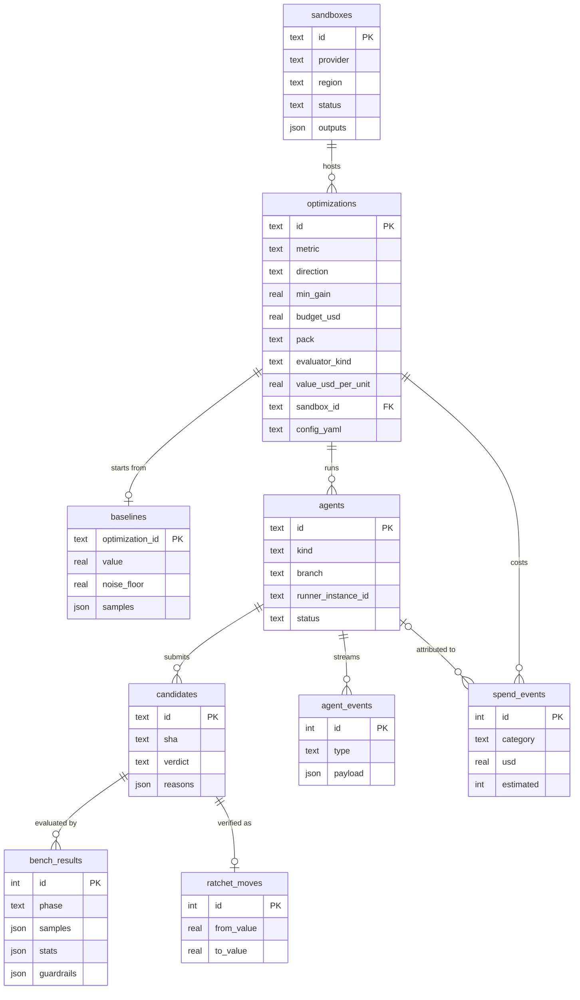

# Ratchet v0 — Architecture

> A ratchet only turns one way. Ratchet lets coding agents try to improve a
> business metric — cut costs or grow profit — and keeps a change only when a
> trusted evaluator confirms it is better, on data the agents never saw.

Status: draft for discussion. UI design: "Ratchet App Design" canvas
(Midnight Brass), six screens; see §9.

## 0. Product shape: a generic core with domain packs

Businesses want two things: lower costs and higher profit. Ratchet is a
**generic verified-improvement platform**: the user declares an objective (a
metric, its direction and what a unit of it is worth in dollars), a trusted
**evaluator**, guardrails and a sealed **holdout**; agents propose changes; the
ratchet keeps only verified wins. The core never looks at the domain.

| | Perf pack (v0) | Forecasting pack (next) | Cost pack (later) |
|---|---|---|---|
| Metric | p95 latency ↓ | WAPE / MAPE ↓ | $ per run ↓ |
| Evaluator `kind` | `benchmark` (k6, criterion, hyperfine) | `backtest` (rolling-origin) | `simulation` / pipeline run + cost meter |
| Holdout | hidden traffic trace | most recent unseen period | held-out partition |
| Domain guardrails | tests, API contract, error rate, memory | no leakage / look-ahead, interface preserved, train-time cap | output equals baseline, SLA |
| Noise | run-to-run variance | seed / fold variance | run variance |
| Value model | $ per ms (infra + conversion) | $ per WAPE point (inventory, stockouts) | $ per $ saved |

A **pack** is evaluator templates + guardrails + holdout strategy + a default
value model + an agent brief, for one domain. Go to market one pack at a time;
the platform is the core underneath. Headline result: **$ value per year
created per $ spent** (`estimateValue`, `returnOnSpend` in core), labelled
*estimated* until measured in production.

## 1. v0 scope

v0 ships the core plus the **perf pack**: latency, throughput, cold start,
build time, cost per run — anything with a reproducible benchmark that prints a
number. The forecasting pack is the next milestone (§10).

| In scope | Out of scope (later) |
|---|---|
| Desktop app (Electron + React, macOS first) as mission control | Hosted controller / web dashboard |
| Agents: **Claude Code** and **Codex**, run headless on Ratchet **agent runners** (EC2 in the sandbox) | Vendor cloud sessions (Claude Code on the web, Codex cloud) as an extra adapter; Grok, OpenCode |
| Cloud: **AWS** only | Azure, GCP, cross-cloud placement |
| GitHub repos with a reproducible benchmark (k6, criterion, pytest-benchmark, hyperfine, custom command) | Repos without a benchmark; ML / forecasting objectives |
| One optimization = one benchmark metric, one budget, one time limit | Multi-metric objectives, cross-agent collaboration |
| Result delivered as a PR plus a benchmark report | Autonomous production deployment |

## 2. Topology

```
┌─────────────────── Ratchet desktop (Electron) ──────────────┐
│ Optimization engine · Ratchet · Budget guard · Ledger · UI  │
│ Runner control · GitHub watcher                             │
│ AWS controller (cost meter, reaper, bench runner)           │
└───────┬──────────────────────────────┬──────────────────────┘
        │ AWS APIs + SSM (admin)       │ watch branches
        ▼                              ▼
 AWS sandbox account                 GitHub
 ├─ agent runner: claude -p ───push──▶ ratchet/<opt>/claude
 ├─ agent runner: codex exec ──push──▶ ratchet/<opt>/codex
 │    └─ experiments: tagged EC2, S3 artifacts (agent boundary)
 ├─ trusted bench runner (eval-only role) ◀── re-bench candidates
 └─ S3 sealed traces (deny agents)
        ▲ model APIs (Anthropic, OpenAI) via runner egress
```

Principles:

1. **The Mac is mission control, not the runtime.** Agents run headless on
   agent runners in the sandbox, each driven by a small `ratchet runner` loop;
   experiments and benchmarks run on AWS too. Work continues if the lid closes.
2. **GitHub is the bus.** Agent = branch, candidate = commit, winner = PR.
3. **Agents never touch the trusted path.** Only benchmarks the app launches,
   with credentials no agent holds, move the ratchet.
4. **Budget is enforced by AWS permissions and the app, never by prompt
   compliance.**

## 3. Core concepts

| Concept | Definition |
|---|---|
| **Optimization** | Repo, benchmark, metric, agents, USD budget, time limit, stop rules |
| **Benchmark** | Command from `ratchet.yaml` that emits metrics (e.g. k6 `http_req_duration.p95`) |
| **Metric** | Name, direction (lower / higher is better), minimum gain, noise floor |
| **Agent** | One Claude Code or Codex instance, run headless on its own agent runner, working on its own branch `ratchet/<opt>/<agent>` |
| **Agent runner** | EC2 instance in the sandbox that hosts one agent plus the `ratchet runner` loop |
| **Candidate** | A commit an agent submits, with cost attributed |
| **Guardrails** | Hard pass/fail checks: tests, API contract, error rate, peak memory |
| **Bench runner** | Trusted re-benchmark of every candidate on pinned hardware |
| **Hidden trace** | Sealed workload agents never see; used to confirm a win |
| **Ratchet** | Pointer to the best *verified* candidate; only moves forward |
| **Ledger** | Append-only record of every spend event, candidate and result |

### Ratchet rule

A candidate becomes a **verified win** iff:

1. all guardrails pass, and
2. its bench result (N runs on pinned hardware) beats the current best by more
   than `max(noise_floor, min_gain)`, and
3. a confirm run on a **fresh instance** against the **hidden trace** also
   beats the current best.

Otherwise it is *rejected* (no gain), *failed confirm* (bench win that did not
hold on the hidden trace) or *blocked* (guardrail failed). The noise floor comes
from running the baseline N times before any agent starts.

## 4. Repository contract: `ratchet.yaml`

```yaml
version: 0
pack: perf                        # informational: which domain pack this follows
objective:
  name: search-api p95 latency
  metric: http_req_duration.p95   # key in the evaluator's JSON output
  direction: minimize
  min_gain: 0.03                  # 3%
  value:                          # business case
    usd_per_unit: 1200            # $ per ms of p95 improvement
    period: year
    basis: estimated              # → measured once confirmed in production
    unit: ms
evaluator:                        # the trusted evaluation (legacy alias: bench)
  kind: benchmark                 # benchmark | backtest | eval | simulation
  ref: ratchet/bench              # protected ref holding the trusted evaluator
  run: k6 run bench/k6/search.js
  repeats: 5                      # also used for the baseline noise floor
  hardware: c7i.2xlarge           # pinned, dedicated host
  holdout: s3://sealed/search-trace.jsonl   # sealed; agents never see it
guardrails:
  - run: pytest -q
  - run: openapi-diff --base main
  - error_rate: "< 0.001"
  - peak_rss: "< 1.2x"
protected:                        # changes here block a candidate
  - bench/**
  - ratchet.yaml
  - tests/contract/**
agent:
  instructions: RATCHET.md        # brief injected into every session
  allowed_instance_types: [c7i.2xlarge, c7i.xlarge, m7i.large]
```

The evaluator comes from `evaluator.ref`, never from the candidate's tree, so an
agent cannot change how it is scored. A forecasting config looks the same with
`kind: backtest`, `metric: wape` and `holdout:` pointing at the latest unseen period.

## 5. Agents: headless on agent runners

Both agents have documented headless modes, so v0 runs them on EC2 machines
Ratchet controls instead of depending on vendor-hosted cloud sessions.

| | Claude Code | Codex |
|---|---|---|
| Headless entry point | `claude -p --output-format stream-json` (or Claude Agent SDK) | `codex exec --json` (or Codex SDK) |
| Continue a session | resume by session id | resume the previous exec session |
| Auth | Anthropic API key (subscription only where terms allow) | OpenAI API key or ChatGPT sign-in, per terms |

### Agent runner

One EC2 instance per agent, launched by the app into the sandbox:

1. Boots a Ratchet runner image (Node, git, agent CLIs, profilers, AWS CLI).
2. Clones the repo, checks out `ratchet/<opt>/<agent>`.
3. Runs `ratchet runner` (from `packages/core`), which drives the loop
   locally: build the prompt from `RATCHET.md` + `.ratchet/context.md`, invoke
   the agent headless, stream its JSON events to S3, wait for the verdict on
   each candidate, resume the agent with the result.
4. The app tails the event stream (S3 / SSM) for the Live agents screen and
   can send messages, pause or stop via SSM.

Because the loop runs on the runner, agents keep iterating when the Mac is
asleep; the app only observes and enforces limits.

```ts
interface AgentAdapter {                          // runs inside `ratchet runner`
  kind: "claude-code" | "codex";
  preflight(): Promise<Preflight>;                // CLI present, auth valid
  start(spec: AgentSpec): Promise<SessionHandle>;
  resume(session: SessionHandle, message: string): Promise<void>;
  events(session: SessionHandle): AsyncIterable<AgentEvent>;   // parsed stream-json
  stop(session: SessionHandle): Promise<void>;
}
```

### Secrets on the runner

- Model API keys and a repo-scoped GitHub token (fine-grained token or GitHub
  App installation token) are written by the app to SSM Parameter Store
  (SecureString), readable only by that runner's role. Never in OpenTofu state.
- AWS access comes from the runner's **instance profile** (§7), so credentials
  rotate automatically.

### Later: vendor cloud sessions

Claude Code on the web and Codex cloud tasks can be added as another adapter
if their programmatic APIs and terms support it. Same `AgentAdapter`
interface; the runner is skipped.

## 6. The improvement loop

- **Runner-driven (always):** `ratchet runner` gives the agent `RATCHET.md`
  plus a generated `.ratchet/context.md` (metric, current best, past
  candidates, remaining budget, rules). The agent iterates: profile →
  hypothesize → change → run experiments → commit → submit. After each verdict
  the runner resumes the agent with the result and the current best, and
  rebases onto the ratchet best (shared baseline, independent exploration).
- **User-steered (optional):** from the Live agents screen the user can send a
  message, pause or stop; the app relays it to the runner via SSM.

**Submitting:** the agent pushes a commit with a `Ratchet-Candidate: true`
trailer. The watcher checks `protected` paths and queues the candidate for the
bench runner.

**Bench runner pipeline** (one candidate at a time, queue visible in the UI):
candidate → guardrails → bench × N → confirm on hidden trace → verdict.

**Stopping:** budget exhausted, time limit reached, N evals with no gain, or a
manual stop ("Stop & revoke keys").

## 7. AWS design

### Infrastructure as code: OpenTofu + sandbox contract

Sandbox infrastructure is defined in **OpenTofu** (Linux Foundation fork of
Terraform; MPL-licensed, so safe to bundle). Cloud independence comes from a
**sandbox contract**: every cloud module takes the same inputs and produces
the same outputs, and the app depends only on the contract.

```
infra/
  contract.md        # what every sandbox must provide
  aws/               # v0
  gcp/  azure/       # later
```

```hcl
# Inputs — identical for every cloud
variable "sandbox_id"             { type = string }
variable "region"                 { type = string }
variable "allowed_instance_types" { type = list(string) }

# Outputs — identical for every cloud
output "artifacts_bucket"   { value = ... }  # agent read/write, per-agent prefix
output "sealed_bucket"      { value = ... }  # confirm runner only
output "agent_boundary_ref" { value = ... }  # AWS: permission boundary ARN
output "eval_identity_ref"  { value = ... }  # AWS: bench runner role / profile (no sealed access)
output "confirm_identity_ref" { value = ... } # AWS: confirm-only role / profile (reads the holdout traces)
output "network_ref"        { value = ... }  # AWS: subnet + security group
```

In core, `SandboxProvider` wraps the contract; `AWSSandboxProvider` is the
only v0 implementation.

| Layer | Lifetime | Mechanism |
|---|---|---|
| Sandbox (buckets, boundary, runner role, network) | Long-lived | **OpenTofu** |
| Agent runners, per-agent role, secrets, kill switch | Minutes–hours | Cloud SDK from the app (`RunnerLauncher`, `CredentialMinter`) |
| Experiment instances | Seconds–hours | Agents via AWS CLI from the runner, inside the boundary |
| Cost meter, reaper | Continuous | Cloud SDK from the app, filtered by tag |

**Operation:** the app bundles a pinned `tofu` binary; setup shows the
`tofu plan` diff in the app before `apply`; teardown is `tofu destroy`; it uses
the user's AWS profile or SSO login; state is local under
`~/Library/Application Support/Ratchet/sandboxes/<id>/` (remote S3 backend
later).

### AWS sandbox module (v0)

Into a **dedicated sandbox account**, `infra/aws` creates its own VPC and these
resources (the optional proxy is off by default):

| Resource | Purpose |
|---|---|
| `aws_s3_bucket.artifacts` | Agent event streams and build outputs, one prefix per agent; `bench-inputs/` (staged candidates, read-only for the bench) and `bench-results/` |
| `aws_s3_bucket.sealed` | Hidden traffic traces, confirm runner only (holdout prefix) |
| `aws_s3_bucket_policy.sealed_deny_agents` | Explicit deny for every agent identity and for the bench runner |
| `aws_iam_policy.agent_boundary` | Permission boundary for every agent role (launch only into the agent subnet, never with bench/endpoint/proxy groups) |
| `aws_iam_role.bench_runner` + `aws_iam_instance_profile.bench_runner` | Trusted bench for `baseline`/`bench` phases: **no sealed access** |
| `aws_iam_role.confirm_runner` + `aws_iam_instance_profile.confirm_runner` | Trusted bench for `confirm` only: reads the holdout prefix of the sealed bucket |
| `aws_vpc.sandbox`, `aws_subnet.bench`, `aws_subnet.agent`, route tables, internet gateway | Dedicated network; the bench subnet has no route to the internet |
| `aws_vpc_endpoint.s3` (gateway, bucket-restricted policy) + 4 interface endpoints (`ssm`, `ssmmessages`, `ec2messages`, `logs`) | The only ways out of the bench subnet |
| `aws_security_group.agent_runner` | Egress HTTPS + DNS (or, with the proxy, only proxy / endpoints / S3) |
| `aws_security_group.bench` | Load generator ↔ target and the endpoints only; no inbound from agents, no internet |
| `aws_security_group.endpoints` | 443 from the bench and agent subnets to the interface endpoints |
| `aws_subnet.proxy`, `aws_security_group.egress_proxy`, `aws_instance.egress_proxy` | **Optional** (`enable_egress_proxy`): squid allow-list proxy (~$7.5/month; Network Firewall would be ~$290) |

Per-agent roles, runner instances, bench instances and SSM secrets are created
by the app per optimization (below), not by OpenTofu.

### Agent credentials (per agent)

- An optimization-scoped **IAM role per agent**, attached to its runner as an
  instance profile and capped by `agent_boundary`:
  - EC2 `RunInstances` only with tag `ratchet:opt=<id>`, allow-listed types,
    max instances (default 4) and max lifetime (default 2 h),
    `InstanceInitiatedShutdownBehavior=terminate`
  - S3 only under `artifacts/<opt>/<agent>/`; SSM read only on its own secrets
  - Explicit deny on the sealed bucket, IAM, billing, everything else
- Credentials come from instance metadata and rotate automatically; nothing
  long-lived is handed to the agent.
- **Kill switch:** attach deny-all to the role (immediate), stop the agent via
  SSM, terminate the runner.
- Role, profile and secrets are deleted when the optimization ends.

### Trusted bench runner

1. Watcher sees a candidate on an agent branch.
2. App stages the candidate (code) and `bench.ref` (benchmark) as archives in
   the artifacts bucket (`bench-inputs/`), then launches pinned hardware (e.g.
   `c7i.2xlarge`, load generator in the same AZ) in the **private bench subnet**
   with the `bench_runner` role (`baseline`/`bench` phases) or the
   `confirm_runner` role (`confirm` only). The instance has no internet and no
   git credentials: it downloads the archives through the S3 endpoint.
3. Setup, guardrails and the benchmark run as an unprivileged OS user that
   cannot reach instance metadata (iptables owner rule, IMDSv2 hop limit 1).
4. Runs guardrails, then the benchmark N times; if it beats the best, runs the
   confirm on a fresh instance against the hidden trace (fetched by a root
   pre-step; the bench process can read but not replace it).
5. Writes result JSON to S3; the app updates the ledger and ratchet and
   notifies the agent.

### Cost metering and reaper

- **Live estimate:** tagged resources × on-demand/spot price, every minute,
  attributed to agent runners, agent experiments, bench runner and
  storage/egress. Model token usage is read from the agents' JSON event stream
  and shown alongside.
- **Reconcile:** Cost Explorer by tag after the fact (~24 h lag).
- **Guard:** warn at 80% of budget; at 100%, kill switch plus reaper.
- **Reaper:** terminates tagged resources past max lifetime, belonging to a
  stopped agent, or left after the optimization ends. Agent runners also
  enforce the time limit and budget stop locally. Backstop later: EventBridge
  + Lambda in the sandbox account for when the Mac is offline.

## 8. Tech stack

**Decision: TypeScript everywhere, Electron for the desktop shell, engine kept
headless.** The engine is a standalone package with no UI dependency, so the
same code becomes the open-source CLI now and the hosted controller later, and
the shell can be swapped (Tauri, GPUI) without touching the engine.

```
packages/
  core/      TypeScript (Node): engine, ratchet rule, ledger, agents, AWS, sandbox
  cli/       `ratchet` CLI over core              ← free / open-source; `ratchet runner` on agent runners
  desktop/   Electron main + React renderer       ← the six screens
  ui/        design-system tokens + components (Midnight Brass)
infra/       OpenTofu modules + sandbox contract
```

| Need | Choice |
|---|---|
| Language | TypeScript (strict), Node LTS; pnpm workspaces |
| Desktop shell | Electron: core runs in the main process (or a utility process), renderer talks to it over typed IPC |
| UI | React + TypeScript, Tailwind themed with the tokens below, visx/d3 for charts |
| Storage | SQLite via better-sqlite3 + Drizzle; same schema locally and when hosted |
| Secrets | OS keychain via Electron `safeStorage` / keytar |
| Cloud | AWS SDK for JavaScript v3; bundled, pinned `tofu` binary |
| Git / GitHub | `git` CLI + Octokit |
| Agents | `claude -p` / `codex exec` headless (or their SDKs) on agent runners; runner image built with Packer or EC2 Image Builder |
| Runner control | AWS SSM (start / message / stop), event stream to S3 |
| Long-running work | in-process job queue in core, swappable for a durable queue when hosted |
| Packaging | electron-builder; macOS Developer ID + notarization, auto-update; Linux/Windows later at little cost |

**Why Electron over Tauri:** one language (no Rust layer, no sidecar
packaging), identical Chromium rendering on every OS for chart-heavy screens,
and the most mature tooling (auto-update, native modules, DevTools). Accepted
cost: larger download and memory use (~150 MB vs ~10 MB). Revisit Tauri if
footprint or a stricter security story becomes a customer ask; revisit GPUI if
web-view performance limits the live screens.

**Security notes:** `contextIsolation` on, `nodeIntegration` off in the
renderer, a narrow preload API; AWS keys and tokens never reach the renderer.

```
packages/core/src/
  optimization/ engine, ratchet, stop-rules
  agents/       adapter, claude-code, codex, runner-loop
  github/       branch-watcher, pr-builder
  sandbox/      provider, tofu-runner, aws-provider
  aws/          runner-launcher, credential-minter, cost-meter, reaper, bench-runner
  ledger/       schema, store
packages/desktop/src/renderer/screens/
  Optimizations, NewOptimization, Environment, LiveAgents, BenchmarkHistory, Result
```

### Ledger schema

One SQLite file per machine (`packages/core/src/ledger/schema.ts`). It is the
single source of truth for an optimization: the engine resumes from it after a
crash, and every screen reads it. Pre-release there is one migration,
`0000_init.sql`. Timestamps are epoch ms, money is USD, JSON columns are TEXT.



| Table | Rule |
|---|---|
| `optimizations` | Snapshot of `ratchet.yaml` plus the columns screens filter on: metric, pack, evaluator kind, $ value model (`value_*`, all null without one) |
| `candidates` | One row per (agent, sha); verdict `pending → verified / rejected / failed_confirm / blocked` |
| `bench_results` | `phase = bench` (visible trace) or `confirm` (holdout) |
| `ratchet_moves` | **Append-only** (triggers reject UPDATE/DELETE); one per verified win, strictly improving |
| `spend_events` | **Append-only**; corrections are new rows, possibly negative |
| `sandboxes` | `planned → applying → applied → destroying → destroyed / failed`, driven by the engine (`planSandbox`, `applySandbox`, `destroySandbox`); tofu outputs stored on apply and the live runtime is built from them. Live optimizations are linked via `optimizations.sandbox_id` and need an applied sandbox; destroy is refused while one is running or any tagged instance remains |
| `engine_kv` | Crash-safe engine bookkeeping (stop mode, plateau counters), keys `opt:<id>:…` |

Enums (statuses, verdicts, agent kinds, evaluator kinds, value period/basis)
are CHECK constraints, so a bad value fails in the database, not just in zod.

## 9. UI

### Design system: Midnight Brass

Dark, precise, "instrument panel" look. Implement as tokens in `packages/ui`.

| Token | Value | Use |
|---|---|---|
| Window / sidebar / card | `#0B1019` / `#0E1420` / `#111827` | Layered surfaces, 1px hairlines `rgba(148,163,190,.13)` |
| Text / secondary / tertiary | `#ECEFF4` / `#A7B1C2` / `#8592A6` | All pass 4.5:1 on cards |
| Brass (accent) | `#D9B26F`, highlight `#EBCB8E` | Primary actions, ratchet line, live state, trusted path |
| Mint | `#7BD8B0` | Verified wins, passed guardrails |
| Rose | `#F08A93` | Blocked, stop / revoke |
| Claude Code / Codex | lilac `#B8A6FF` / sky `#7CC4F2` | Agent avatars and chart points |

- **Type:** Instrument Serif for page titles and hero numbers; Instrument Sans
  for UI; JetBrains Mono for metrics, SHAs, code (tabular figures).
- **Shape:** 14px card radius, 8–10px controls, uppercase tracked eyebrow
  labels, subtle dot-grid behind charts.

### Screens

1. **Optimizations:** KPI cards (verified wins, median gain, spend, cost per
   win), live run with ratchet chart, activity feed, table of all runs.
2. **New optimization:** four steps (target, benchmark & metric, guardrails,
   agents & limits) plus a review panel with the generated `ratchet.yaml` and
   preflight checks; primary action "Run baseline & start".
3. **AWS sandbox:** architecture diagram (trusted path in brass), OpenTofu plan
   diff, account details, agent limits, contract outputs.
4. **Live agents:** one card per agent (hypothesis, recent eval bars, stats,
   live log, message / open session / pause) and the bench runner pipeline.
5. **Benchmark history:** ratchet chart with noise band, latency histogram
   baseline vs. best, percentile table, every candidate with its verdict.
6. **Result:** headline before → after, time by code path, winning diff,
   per-agent results, spend breakdown, teardown checklist, "Open pull
   request".

## 10. Milestones

1. **M0, skeleton:** pnpm monorepo (core, cli, desktop, ui), Electron shell, design tokens, `ratchet.yaml` parser,
   ledger, GitHub watcher.
2. **M1, AWS sandbox:** contract, OpenTofu AWS module, `tofu` runner, agent runner image + launcher,
   credential minter, cost meter, reaper.
3. **M2, trusted bench:** bench runner, guardrails, noise-floor baseline,
   hidden-trace confirm, ratchet rule.
4. **M3, first agent:** Claude Code headless on an agent runner, `ratchet runner` loop, end to end on a demo service.
5. **M4, second agent:** Codex adapter; parallel agents; shared ratchet.
6. **M5, demo:** a sample HTTP service (k6 p95) plus one CLI cold-start
   benchmark (hyperfine), with cost per verified win reported.

## 11. Open questions

1. Terms: can a user's Claude or ChatGPT **subscription** drive the agents on
   a Ratchet runner, or is it API keys only? (Check before M3.)
2. Runner image: one shared image with every toolchain, or built per repo
   from a `ratchet.yaml` setup step?
3. Agents on EC2 only, or also ECS / Lambda for serverless targets?
4. Model token spend: counted against the budget, or shown separately?
5. How are hidden traces produced: captured from production, or generated?
